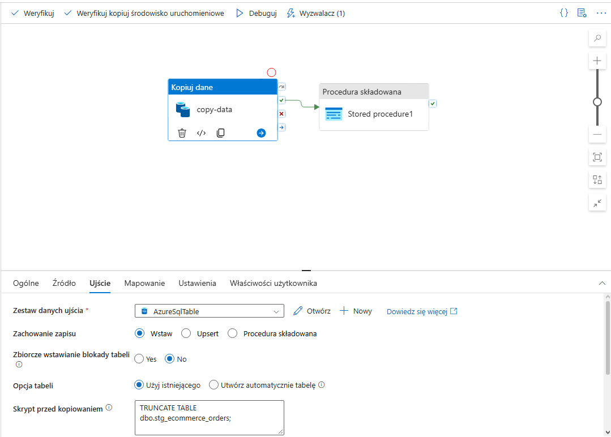
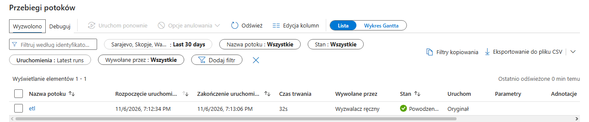

# Azure E-Commerce Order Data ELT Pipeline

An end-to-end, automated cloud data pipeline (ELT) built on Microsoft Azure. This project extracts synthetic e-commerce orders via a Python script, stages them securely in Azure Blob Storage, orchestrates data movement and transformation using Azure Data Factory (ADF), and loads clean analytical metrics into an Azure SQL Database fact table without duplication.

---

## Architecture & Data Flow

The pipeline follows a robust ELT architecture designed for cost efficiency and data integrity:

1. **Extraction (Python):** A custom Python script pulls data from an external e-commerce API (users and products), generates realistic transaction datasets, and uploads the raw CSV directly to Azure Blob Storage.
2. **Extract & Load / Staging (ADF):** Azure Data Factory triggers a copy activity that ingests the raw file into an Azure SQL staging table (`stg_ecommerce_orders`). A pre-copy script executes a `TRUNCATE` command prior to loading to prevent duplicate record accumulation.
3. **Transformation & Final Load (SQL Serverless):** Immediately after staging, an ADF stored procedure activity runs `sp_transform_ecommerce_orders`. This script handles text formatting (`LTRIM`/`RTRIM`), manages missing values (`ISNULL`), calculates line item totals (`TotalPrice = Quantity * UnitPrice`), and refreshes the analytical fact table (`fact_ecommerce_orders`).
4. **Automation:** The pipeline execution is fully automated using an ADF weekly schedule trigger.

---

## Project Structure

- sql/
  - create_staging_table.sql         # DDL script for staging table
  - create_fact_table.sql            # DDL script for analytical fact table
  - sp_transform_ecommerce_orders.sql# Stored procedure handling transformation logic
- screenshots/
  - adf_pipeline.png                 # ADF pipeline workflow screenshot
  - adf_monitoring.png               # ADF monitoring and trigger runs screenshot
- .gitignore                           # Excludes sensitive data, credentials, and local files
- requirements.txt                     # Python dependencies
- generate_data.py                     # Python script for data generation and Azure upload

---

## Screenshots
> Please note: While the rest of the project documentation and code are maintained in English, the monitoring screenshots reflect the Azure portal language settings (Polish).
### 1. Azure Data Factory Pipeline Workflow
The orchestration pipeline showing the copy activity followed by the stored procedure transformation.

### 2. Pipeline Monitoring & Trigger Runs
Automated weekly executions tracked via ADF Monitoring.

---

## Key Implementation Highlights

* **Idempotency & Clean State:** Solved typical data duplication issues in recurring pipelines by implementing strict `TRUNCATE` steps in both ADF pre-copy configurations and internal SQL procedures.
* **Cost Optimization:** Leveraged Azure SQL Database Serverless tiers to ensure resources scale down and pause during idle periods, minimizing maintenance costs for portfolio/test environments.
* **Security Best Practices:** Decoupled sensitive credentials (Azure connection strings) from source code by utilizing environment variables (`os.getenv`), protected by a strict `.gitignore` configuration.

---

## Getting Started

1. Clone the repository.
2. Install Python dependencies:
   `pip install -r requirements.txt`
3. Set up your environment variables for Azure Blob Storage:
   `export AZURE_STORAGE_CONNECTION_STRING="your_connection_string_here"`
4. Run the script to generate synthetic data and upload it to Azure Blob Storage:
   `python generate_data.py`